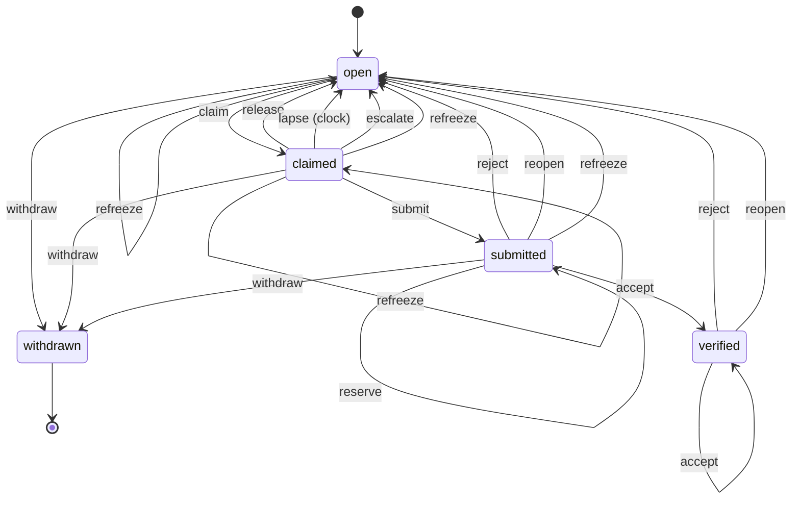

# The item lifecycle

Generated from src/machine.js by `pullboard lifecycle`. Do not edit it by hand: change the declaration, then run `pullboard lifecycle > docs/lifecycle.md`.

An item starts open. Its final states, withdrawn, cannot be left. Every move into a guarded state passes the same transition guards, whatever command gets there. The board file itself refuses any move not declared here.

## Frozen check policy

The coordinator may set `check.install` and `check.timeout` in committed `pullboard.json`; the defaults are no install command and `5m`. Accept runs the configured install and the frozen item check in a private clone, under one timeout budget. It reuses the verifier’s npm cache when available. Install commands that need network downloads conflict with P2 (offline); configure an offline install or make its needed packages available in the cache.

Private commands drain their output through pipes, retaining a bounded 8 MiB capture of its beginning and end. Failed or unverifiable checks stream the complete log through secret scanning into an owner-readable artifact; lines over 64 KiB of UTF-8 data are replaced with a safe-scan marker. Output beyond the capture cap does not fail a successful command, and dependency files and build artifacts have no capture-size limit. A timeout kills the command's process group. An unverified check names how to restore the environment and retry; a failing check names rejection or builder rework as the next step.

## States

| State | Means | Fields it needs |
| --- | --- | --- |
| open | waiting for a builder; claimable once what it waits on is verified | none |
| claimed | an agent holds it under a lease, its criterion frozen | item_owner, item_lease_until, item_frozen_digest |
| submitted | built and gated green at a pinned commit, waiting for another agent | item_built_by, item_commit, item_frozen_digest |
| verified | another agent accepted it at the submitted commit | item_verified_by, item_commit |
| withdrawn (final) | nobody should build it; the reason stays on it | item_withdrawn_reason |

## Moves

Each move checks its guards in this order and refuses with the first one that does not hold; result-path refusals are listed separately.

| Move | From | To | Who | Guards, in order; result refusals |
| --- | --- | --- | --- | --- |
| claim | open, claimed | claimed | agent, coordinator | joined (NOT_JOINED or SESSION_LEDGER), itemExists (NO_ITEM), inState (NOT_CLAIMABLE), checkProvesSomething (CRITERION_PROVES_NOTHING), itemNotHeld (ITEM_HELD), inLane (WRONG_LANE), routeAllows (ROUTE), dependenciesVerified (BLOCKED), notHeldByAnother (HELD), builderFirstRefusal (REOPEN_HELD_FOR_BUILDER), correctionRefrozen (PENDING_REFREEZE), laneOpen (LANE_HELD), oneLiveClaim (ONE_CLAIM), rowsInForce (UNKNOWN_SPEC or A5_GRAMMAR_VERSION or NO_POLICY or BAD_CONFIG or SPEC_BEHIND_MAIN or AGENT_APPROVAL_REQUIRED) |
| release | open, claimed | open | agent, coordinator | joined (NOT_JOINED or SESSION_LEDGER), itemExists (NO_ITEM), inState (NOT_YOURS), releaseOwnsWork (NOT_YOURS), reviewReleaseExplained (NOTE_REQUIRED) |
| lapse | claimed | open | clock, when its lease runs out | none |
| submit | claimed | submitted | agent, coordinator | joined (NOT_JOINED or SESSION_LEDGER), itemExists (NO_ITEM), inState (NOT_YOURS), isHolder (NOT_YOURS), correctionRefrozen (PENDING_REFREEZE), checkProvesSomething (CRITERION_PROVES_NOTHING), criterionUnchanged (CRITERIA_CHANGED), treeClean (DIRTY), nothingUntracked (UNTRACKED), hasCommit (NO_COMMIT or HOST_NAME), withinLane (OUTSIDE_LANE or NO_POLICY or BAD_CONFIG or GIT_GRAFTS), trunkMergeClean (MERGE_CONFLICT or MERGE_CHECK_FAILED or NO_POLICY or NO_TRUNK), noUnverifiedStack (STACKED_ON_UNVERIFIED), infraExplained (INFRA_NOTE_REQUIRED), doctrineHolds (RATCHET_ROSE or RATCHET_UNCOUNTED), gateConfigured (NO_GATE), queuedItemLease (ITEM_LEASE_LOST or A5_GRAMMAR_VERSION or SPEC_BEHIND_MAIN or NOT_A_REPO or NO_CONFIG), gateGreen (GATE_RED or LAND_TIMEOUT_CUSTODY or LAND_GATE_OUTPUT or SLOT_DB_LOCKED or RUNNER_BROWSER_SLOT_REQUIRED or PIPEFAIL_UNAVAILABLE), treeStillDuringGate (MOVED_DURING_GATE), submissionProofValid (SUBMISSION_PROOF), childrenDone (CHILDREN_OPEN), headIsNew (HEAD_NOT_NEW) |
| reserve | submitted | submitted | agent, coordinator | coordinatorSaysAs (MAIN_IS_COORDINATOR), joined (NOT_JOINED or SESSION_LEDGER), roadmapReadable (MILESTONES_CORRUPT), itemExists (NO_ITEM), inState (NOT_SUBMITTED), reviewCooldownElapsed (REVIEW_COOLDOWN), notBuilder (SELF_VERIFY or VERIFIER_STANDING or SELF_SESSION_VERIFY), routeAllows (ROUTE), policyAllows (COORDINATOR_VERIFIES), familyAllows (O2_FAMILY_MATCH), reviewFree (REVIEW_HELD) |
| accept | submitted, verified | verified | agent, coordinator | coordinatorSaysAs (MAIN_IS_COORDINATOR), joined (NOT_JOINED or SESSION_LEDGER), itemExists (NO_ITEM), inState (NOT_SUBMITTED), atSubmittedCommit (NOT_AT_COMMIT or OUTSIDE_LANE or NO_POLICY or BAD_CONFIG or GIT_GRAFTS), notMerged (ALREADY_MERGED), verdictReviewRecorded (BAD_VERDICT_REVIEW), reviewTreeCurrent (STALE_VERDICT or DIRTY or UNTRACKED or VERDICT_TRUNK_MOVED), notBuilder (SELF_VERIFY or VERIFIER_STANDING or SELF_SESSION_VERIFY), routeAllows (ROUTE), policyAllows (COORDINATOR_VERIFIES), familyAllows (O2_FAMILY_MATCH), reviewFree (REVIEW_HELD), criterionUnchanged (CRITERIA_CHANGED), reasonIsMet (BAD_REASON), trunkMergeClean (MERGE_CONFLICT or MERGE_CHECK_FAILED or NO_POLICY or NO_TRUNK), noUnverifiedStack (STACKED_ON_UNVERIFIED), queuedItemLease (ITEM_LEASE_LOST or A5_GRAMMAR_VERSION or SPEC_BEHIND_MAIN or NOT_A_REPO or NO_CONFIG), itemCheckGreen (CHECK_RED or SLOT_DB_LOCKED or CHECK_UNVERIFIED or GUARD_CANNOT_FAIL or GUARD_NOT_FOUND), proofNoted (PROOF_REQUIRED), result (LAND_HEADER), result (ENGINE_VERSION) |
| reject | submitted, verified | open | agent, coordinator | coordinatorSaysAs (MAIN_IS_COORDINATOR), joined (NOT_JOINED or SESSION_LEDGER), itemExists (NO_ITEM), inState (NOT_SUBMITTED), atSubmittedCommit (NOT_AT_COMMIT or OUTSIDE_LANE or NO_POLICY or BAD_CONFIG or GIT_GRAFTS), notMerged (ALREADY_MERGED), verdictReviewRecorded (BAD_VERDICT_REVIEW), reviewTreeCurrent (STALE_VERDICT or DIRTY or UNTRACKED or VERDICT_TRUNK_MOVED), notBuilder (SELF_VERIFY or VERIFIER_STANDING or SELF_SESSION_VERIFY), routeAllows (ROUTE), policyAllows (COORDINATOR_VERIFIES), familyAllows (O2_FAMILY_MATCH), reviewFree (REVIEW_HELD), criterionUnchanged (CRITERIA_CHANGED), reasonCoded (BAD_REASON), noteGiven (NOTE_REQUIRED), causeWellFormed (BAD_CAUSE), result (LAND_HEADER), result (ENGINE_VERSION), result (NOT_YOURS), result (CLOSED) |
| reopen | submitted, verified | open | coordinator | joined (NOT_JOINED or SESSION_LEDGER), itemExists (NO_ITEM), inState (NOT_SUBMITTED), coordinatorOnly (COORDINATOR_ONLY), noteGiven (NOTE_REQUIRED), causeWellFormed (BAD_CAUSE), notMerged (ALREADY_MERGED), landingFailureRecorded (LANDING_FAILURE_REQUIRED), trunkConflicts (NOT_CONFLICTING or CONFLICT_FILES or NO_TRUNK or MERGE_CHECK_FAILED), conflictAccepted (NOT_ACCEPTED or BAD_CONFLICT or ENGINE_VERSION), result (BAD_CONFIG) |
| escalate | open, claimed | open | agent, coordinator | joined (NOT_JOINED or SESSION_LEDGER), noteGiven (NOTE_REQUIRED), itemExists (NO_ITEM), holderOrCoordinator (NOT_YOURS), inState (CLOSED) |
| refreeze | open, claimed, submitted | open | coordinator, when there is no live claim awaiting a coordinator correction | joined (NOT_JOINED or SESSION_LEDGER), coordinatorOnly (COORDINATOR_ONLY), itemExists (NO_ITEM), inState (CLOSED), rowsInForce (UNKNOWN_SPEC or A5_GRAMMAR_VERSION or NO_POLICY or BAD_CONFIG or SPEC_BEHIND_MAIN or AGENT_APPROVAL_REQUIRED) |
| refreeze | claimed | claimed | agent, coordinator, when a live claim has a pending coordinator correction | joined (NOT_JOINED or SESSION_LEDGER), itemExists (NO_ITEM), holderOrCoordinator (NOT_YOURS), inState (CLOSED), rowsInForce (UNKNOWN_SPEC or A5_GRAMMAR_VERSION or NO_POLICY or BAD_CONFIG or SPEC_BEHIND_MAIN or AGENT_APPROVAL_REQUIRED) |
| withdraw | open, claimed, submitted | withdrawn | coordinator | joined (NOT_JOINED or SESSION_LEDGER), coordinatorOnly (COORDINATOR_ONLY), noteGiven (NOTE_REQUIRED), itemExists (NO_ITEM), inState (CLOSED) |

## Required transition guards

| State entered | Every move into it passes |
| --- | --- |
| verified | atSubmittedCommit, notBuilder, criterionUnchanged, proofNoted |
| withdrawn | coordinatorOnly, noteGiven |

## Refusals

| Code | Raised when this does not hold | Next step |
| --- | --- | --- |
| NOT_CLAIMABLE | claim: the item is in open, claimed | pullboard show <id> |
| NOT_YOURS | release: the item is in open, claimed | pullboard show <id> |
| NOT_YOURS | submit: the item is in claimed | pullboard show <id> |
| NOT_SUBMITTED | reserve: the item is in submitted | pullboard show <id> |
| NOT_SUBMITTED | accept: the item is in submitted, verified | pullboard show <id> |
| NOT_SUBMITTED | reject: the item is in submitted, verified | pullboard show <id> |
| NOT_SUBMITTED | reopen: the item is in submitted, verified | pullboard show <id> |
| CLOSED | escalate: the item is in open, claimed | pullboard show <id> |
| CLOSED | refreeze: the item is in open, claimed, submitted | pullboard show <id> |
| CLOSED | refreeze: the item is in claimed | pullboard show <id> |
| CLOSED | withdraw: the item is in open, claimed, submitted | pullboard show <id> |
| NOT_JOINED | the caller is the main checkout, or a worktree that joined a lane; an agent session's claims, submits and verdicts can be checked against its local ledger | pullboard join <lane> --model "<model name>" (see: pullboard lanes) |
| SESSION_LEDGER | the caller is the main checkout, or a worktree that joined a lane; an agent session's claims, submits and verdicts can be checked against its local ledger | make the agent-session ledger named in the message readable and writable by this user, then run the command again |
| NO_ITEM | the item exists | pullboard list --all |
| COORDINATOR_ONLY | the caller is the coordinator | run it from the main checkout |
| MILESTONES_CORRUPT | the roadmap is readable when selecting the next review, only next --verify selection; a review reserved by id does not consult the roadmap | restore board metadata from a known-good board export |
| MAIN_IS_COORDINATOR | in the main checkout, the caller says it is the coordinator | verify from your own worktree; the coordinator adds --as coordinator |
| NOT_YOURS | the caller holds the item, or is the coordinator | shout its holder, or the coordinator |
| NOT_YOURS | the caller holds the claim or is the builder yielding its active first-refusal window | release your own claim or reservation, or ask the current builder |
| NOT_YOURS | the caller holds the claim | pullboard claim <id> |
| WRONG_LANE | the item is in the caller's lane; the main checkout builds coordinator-lane items only | cd <the lane's worktree> && pullboard claim <id> |
| ROUTE | the caller's route covers the item's: light, then mid, then strong | pullboard next, which offers only items your route covers |
| BLOCKED | every item it waits on is verified | claim another item, or shout the lane it waits on |
| REOPEN_HELD_FOR_BUILDER | a returned item waits for its original builder until its recorded deadline or builder release | wait until the named deadline, or ask its builder to run pullboard release <id> |
| HELD | no other agent holds it under a live lease | pullboard next |
| LANE_HELD | nobody holds its lane, unless the caller is renewing its own live claim | pullboard next --wait 9 (minutes) |
| ITEM_HELD | the coordinator has not put this item on hold, unless the caller is renewing its own live claim | the coordinator lifts it with pullboard hold <id> --off |
| PENDING_REFREEZE | no coordinator correction to a claimed criterion or check is waiting to be frozen | pullboard refreeze <id> |
| ONE_CLAIM | the caller holds no other live top-level claim, reworks of its own rejected items aside | submit or release the other item first; child items are free |
| UNKNOWN_SPEC | every row the item cites exists and is in force, only where the criterion freezes: claiming an item with no frozen criterion, and refreeze | fix the spec, or the coordinator withdraws the item |
| A5_GRAMMAR_VERSION | every row the item cites exists and is in force, only where the criterion freezes: claiming an item with no frozen criterion, and refreeze | upgrade Pullboard or use a file written for grammar 1 |
| NO_POLICY | every row the item cites exists and is in force, only where the criterion freezes: claiming an item with no frozen criterion, and refreeze | restore the committed coordinator policy |
| BAD_CONFIG | every row the item cites exists and is in force, only where the criterion freezes: claiming an item with no frozen criterion, and refreeze | repair and commit the coordinator configuration |
| SPEC_BEHIND_MAIN | every row the item cites exists and is in force, only where the criterion freezes: claiming an item with no frozen criterion, and refreeze | merge main from this worktree, then retry the claim |
| AGENT_APPROVAL_REQUIRED | every row the item cites exists and is in force, only where the criterion freezes: claiming an item with no frozen criterion, and refreeze | ask the coordinator to arrange the person’s confirmation or decline, or change the explicit refuse setting |
| CRITERIA_CHANGED | the criterion and the rows it cites read as they did at claim | the coordinator runs pullboard refreeze <id> |
| DIRTY | the worktree has no uncommitted changes | commit your changes, then submit |
| UNTRACKED | the worktree has no untracked files | commit or ignore them, then submit |
| NO_COMMIT | there is a commit to submit, and no commit it adds names this machine | commit your work, then submit |
| HOST_NAME | there is a commit to submit, and no commit it adds names this machine | reword the named commit's message without this machine's name (git rebase -i, then reword), then run pullboard submit <id> again |
| NO_GATE | the repo names a gate command | in the main checkout, run pullboard gate set "<project test command>", then commit pullboard.json |
| OUTSIDE_LANE | the full claimed diff respects committed coordinator ownership | restore foreign paths or shout their owner |
| NO_POLICY | the full claimed diff respects committed coordinator ownership | restore the claim base or ask the coordinator to refreeze |
| BAD_CONFIG | the full claimed diff respects committed coordinator ownership | restore the committed coordinator configuration |
| GIT_GRAFTS | the full claimed diff respects committed coordinator ownership | ask the coordinator to remove the Git graft file before retrying |
| MERGE_CONFLICT | the candidate merges cleanly into the current primary branch without changing an index or worktree | merge the trunk into your branch, resolve conflicts, commit and resubmit |
| MERGE_CHECK_FAILED | the candidate merges cleanly into the current primary branch without changing an index or worktree | use Git 2.38 or newer, restore its objects and retry |
| NO_POLICY | the candidate merges cleanly into the current primary branch without changing an index or worktree | restore the primary repository metadata |
| NO_TRUNK | the candidate merges cleanly into the current primary branch without changing an index or worktree | check out the trunk branch in the main checkout once and run pullboard inbox |
| STACKED_ON_UNVERIFIED | the candidate range contains no other item's unverified submitted commit | wait for that item to be accepted, or rebuild without its commits |
| INFRA_NOTE_REQUIRED | edits to tests or gate files that existed at claim carry an explanation | pullboard submit <id> --infra "<why>" |
| RATCHET_ROSE | every touched doctrine check counts (exit 0 or 1), none rises above its committed count and no changed file gains a problem; watch-mode rules only count, only when accepted main has an approved doctrine rule with gate: check | fix the new problems, commit, submit again; only the person's signature raises count: |
| RATCHET_UNCOUNTED | every touched doctrine check counts (exit 0 or 1), none rises above its committed count and no changed file gains a problem; watch-mode rules only count, only when accepted main has an approved doctrine rule with gate: check | fix the check so it exits 0 or 1 within its timeout, then submit again |
| CHECK_RED | the frozen item check passes at the submitted commit, or its clean reviewed composition for a stale acceptance | reject the failing behavior; the builder fixes and resubmits |
| SLOT_DB_LOCKED | the frozen item check passes at the submitted commit, or its clean reviewed composition for a stale acceptance | the run never started, so it is not a red; rerun the same command once the named process releases the slot database |
| CHECK_UNVERIFIED | the frozen item check passes at the submitted commit, or its clean reviewed composition for a stale acceptance | restore the frozen install or check environment and retry |
| GUARD_CANNOT_FAIL | the frozen item check passes at the submitted commit, or its clean reviewed composition for a stale acceptance | reject: the check stays green with the named guard reverted |
| GUARD_NOT_FOUND | the frozen item check passes at the submitted commit, or its clean reviewed composition for a stale acceptance | the named guard is not in the submitted commit; ask the coordinator to fix it |
| CRITERION_PROVES_NOTHING | the item's check does not already pass on main, or the person accepted that exact check, only when accepted main sets checks.provesNothing to "hold" | set a check that fails before the work, or the person runs pullboard check accept <id> |
| GATE_RED | the gate, which submit runs itself every time, is green at HEAD | fix what the digest names, commit, submit again |
| LAND_TIMEOUT_CUSTODY | the gate, which submit runs itself every time, is green at HEAD | inspect the saved timed gate cleanup state and stop only its proven owned processes before starting another landing |
| LAND_GATE_OUTPUT | the gate, which submit runs itself every time, is green at HEAD | inspect the retained timed gate output directory and free disk space, then start another landing |
| SLOT_DB_LOCKED | the gate, which submit runs itself every time, is green at HEAD | the run never started, so it is not a red; rerun the same command once the named process releases the slot database |
| RUNNER_BROWSER_SLOT_REQUIRED | the gate, which submit runs itself every time, is green at HEAD | nothing to do: the run reruns on a local gate slot; if it repeats, set gate.browserByLaunch the same on this machine and that runner |
| PIPEFAIL_UNAVAILABLE | the gate, which submit runs itself every time, is green at HEAD | rewrite the gate without a pipe |
| ITEM_LEASE_LOST | the caller still owns the same live item claim or review and can renew it against the frozen criterion, while submit or an accept waits for a machine slot, and once immediately before admission | claim or reserve the item again before retrying the command |
| A5_GRAMMAR_VERSION | the caller still owns the same live item claim or review and can renew it against the frozen criterion, while submit or an accept waits for a machine slot, and once immediately before admission | upgrade Pullboard or restore a spec written for grammar 1, then retry |
| SPEC_BEHIND_MAIN | the caller still owns the same live item claim or review and can renew it against the frozen criterion, while submit or an accept waits for a machine slot, and once immediately before admission | merge main into this worktree, then renew the claim and retry |
| NOT_A_REPO | the caller still owns the same live item claim or review and can renew it against the frozen criterion, while submit or an accept waits for a machine slot, and once immediately before admission | restore the worktree Git metadata, then retry the command |
| NO_CONFIG | the caller still owns the same live item claim or review and can renew it against the frozen criterion, while submit or an accept waits for a machine slot, and once immediately before admission | restore pullboard.json in this worktree, then retry the command |
| MOVED_DURING_GATE | when the gate ends, HEAD and every tracked file are as they were when it started | leave the worktree alone until the gate finishes, then submit again |
| CHILDREN_OPEN | every child item is verified or withdrawn | finish the child items, or the coordinator withdraws them |
| HEAD_NOT_NEW | a verifier has not rejected this commit at this bar; after a no-verdict reopen, the bar was refrozen | commit the rework, or refreeze the bar after a no-verdict reopen before resubmitting the same commit |
| NOT_AT_COMMIT | the caller's checkout contains the submitted commit | git switch --detach <commit> |
| OUTSIDE_LANE | the caller's checkout contains the submitted commit | restore foreign paths before accepting |
| NO_POLICY | the caller's checkout contains the submitted commit | restore the frozen policy objects |
| BAD_CONFIG | the caller's checkout contains the submitted commit | repair the committed coordinator configuration |
| GIT_GRAFTS | the caller's checkout contains the submitted commit | ask the coordinator to remove the Git graft file before retrying |
| BAD_VERDICT_REVIEW | a new review binds the submitted commit, its exact checked commit, a valid trunk commit and canonical candidate paths | restore the submitted Git objects and retry the review with current Pullboard |
| STALE_VERDICT | a stale acceptance is re-reviewed at a clean HEAD containing the current trunk, which stays fixed through its check | merge current main into the submitted commit and re-review it |
| DIRTY | a stale acceptance is re-reviewed at a clean HEAD containing the current trunk, which stays fixed through its check | commit the reviewed composition before re-reviewing |
| UNTRACKED | a stale acceptance is re-reviewed at a clean HEAD containing the current trunk, which stays fixed through its check | commit or ignore untracked files before re-reviewing |
| VERDICT_TRUNK_MOVED | a stale acceptance is re-reviewed at a clean HEAD containing the current trunk, which stays fixed through its check | merge the latest main and re-review the clean composition |
| SELF_VERIFY | the caller did not build it, and its agent session did not build or submit it under any seat; on a linked board, at engine 48 or newer, the caller was enrolled through the relay by a line of creating seats from the coordinator that includes neither the builder nor a machine join | another agent verifies it: pullboard next --verify |
| VERIFIER_STANDING | the caller did not build it, and its agent session did not build or submit it under any seat; on a linked board, at engine 48 or newer, the caller was enrolled through the relay by a line of creating seats from the coordinator that includes neither the builder nor a machine join | the coordinator makes an independent verifier from the main checkout: pullboard worktree <lane> --model "<model name>" |
| SELF_SESSION_VERIFY | the caller did not build it, and its agent session did not build or submit it under any seat; on a linked board, at engine 48 or newer, the caller was enrolled through the relay by a line of creating seats from the coordinator that includes neither the builder nor a machine join | ask another agent session to verify it: pullboard next --verify from that session's own worktree |
| COORDINATOR_VERIFIES | the repo's verify policy lets the caller verify this lane's work | the coordinator verifies it |
| O2_FAMILY_MATCH | the builder and verifier have different declared families; an undeclared family counts as a match, only when verify.family is require | ask the coordinator for a verifier from another declared family |
| REVIEW_HELD | no other agent holds its review under a live lease | pullboard next --verify, which passes over reviews another agent holds |
| BAD_REASON | an accept gives CRITERION_MET as its reason | a failed criterion is a reject: pullboard verify <id> reject --reason CODE |
| PROOF_REQUIRED | an accept notes how it was proved | --note "what you broke or which edge you tried, and what happened" |
| BAD_REASON | a reject names one of the reject reasons | --reason TEST_FAILURE, BEHAVIOR_MISMATCH, INSUFFICIENT_EVIDENCE, STALE_HEAD or OTHER |
| NOTE_REQUIRED | a review release gives a nonempty one-line reason, engine 5 or newer, only when freeing a submitted review reservation | release with --note "why", or --note-file <file> |
| REVIEW_COOLDOWN | the reviewer has not released this submission within the past hour, engine 5 or newer, only for the same reviewer and current submission | let another reviewer take it, or wait an hour or for a new submission |
| NOTE_REQUIRED | the move carries a note: what failed, what was tried, or why | --note "..." or --note-file <file> |
| BAD_CAUSE | a cause, when given, is test:<file>::<title>, refusal:<CODE>, row:<id>, doctrine:<id> or sentinel:<name> | fix --cause, or leave it out |
| ALREADY_MERGED | the item has no recorded merge receipt | a merged item cannot be reopened |
| SUBMISSION_PROOF | recorded test selection names literal project files and its full-fallback policy, engine 38 or later; absent legacy selection remains unknown | rerun submit with the current CLI |
| LANDING_FAILURE_REQUIRED | a verified item note names the failing test and landing merge commit, unless the reopen names a trunk conflict | cite the recorded batch, or name the test and merge commit in a manual note; work that only conflicts with the trunk reopens with --conflict <file> for each conflicting file |
| NOT_CONFLICTING | the accepted commit no longer merges onto the trunk, and every named file is one that conflicts, only for reopen --conflict by the coordinator on accepted, unmerged work | merge it, or reopen after a red landing with --note "<test file>: <test name>; merge commit <sha>" |
| CONFLICT_FILES | the accepted commit no longer merges onto the trunk, and every named file is one that conflicts, only for reopen --conflict by the coordinator on accepted, unmerged work | name only files Git reports as conflicting with the trunk |
| NO_TRUNK | the accepted commit no longer merges onto the trunk, and every named file is one that conflicts, only for reopen --conflict by the coordinator on accepted, unmerged work | check out the trunk branch in the main checkout once and run pullboard inbox |
| MERGE_CHECK_FAILED | the accepted commit no longer merges onto the trunk, and every named file is one that conflicts, only for reopen --conflict by the coordinator on accepted, unmerged work | use Git 2.38 or newer, restore its objects and retry |
| NOT_ACCEPTED | a trunk conflict reopens an accepted item, names its files and the full trunk commit, and replays only under engine 52 or later, only for reopen --conflict | reopen a submission with --note "why" |
| BAD_CONFLICT | a trunk conflict reopens an accepted item, names its files and the full trunk commit, and replays only under engine 52 or later, only for reopen --conflict | run pullboard reopen <id> --conflict <file> from the main checkout |
| ENGINE_VERSION | a trunk conflict reopens an accepted item, names its files and the full trunk commit, and replays only under engine 52 or later, only for reopen --conflict | upgrade Pullboard on every linked device before using --conflict |
| LAND_HEADER | a displayed merge command fits the commit-header limit (accept result) | shorten the item title or cited rows so the merge header fits |
| ENGINE_VERSION | a verdict that implies items replays only under engine 20 or later (accept result) | upgrade Pullboard on every linked device before using --implies |
| LAND_HEADER | a displayed merge command fits the commit-header limit (reject result) | shorten the item title or cited rows so the merge header fits |
| ENGINE_VERSION | a verdict that implies items replays only under engine 20 or later (reject result) | upgrade Pullboard on every linked device before using --implies |
| NOT_YOURS | the automatic escalation is authorized as the coordinator or item holder (reject result) | ask the coordinator to inspect the item and its route |
| CLOSED | the rejected item remains open or claimed when automatic escalation starts (reject result) | pullboard show <id>, then ask the coordinator to inspect its current state |
| BAD_CONFIG | the configured first-refusal duration fits a valid UTC deadline (reopen result) | set claim.reopenFirstRefusalMinutes to a non-negative whole number within the supported date range, or 0 to disable |
| BAD_DECISION | a verdict is accept or reject | pullboard verify <id> accept, or reject --reason CODE --note "..." |

For check diagnostics, a refusal from a failed or unverifiable check includes an output digest, sanitized tail, and a private full-output path in the CLI message (also `error.message` in JSON). The artifact is owner-readable only. If it cannot be saved, the tail remains available and the message names the storage error instead of claiming a path.
